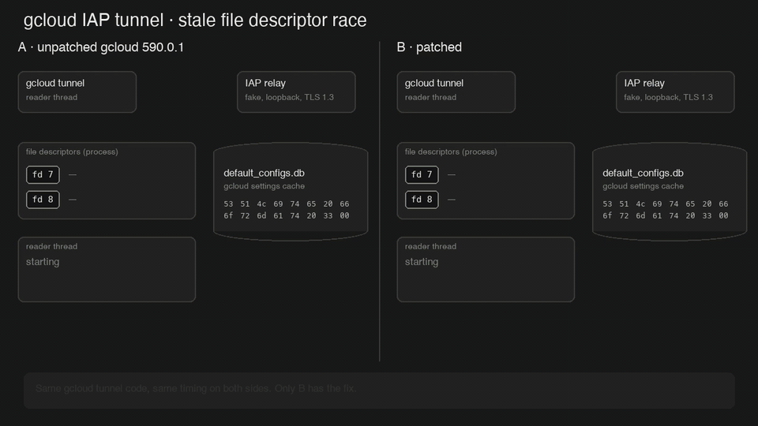
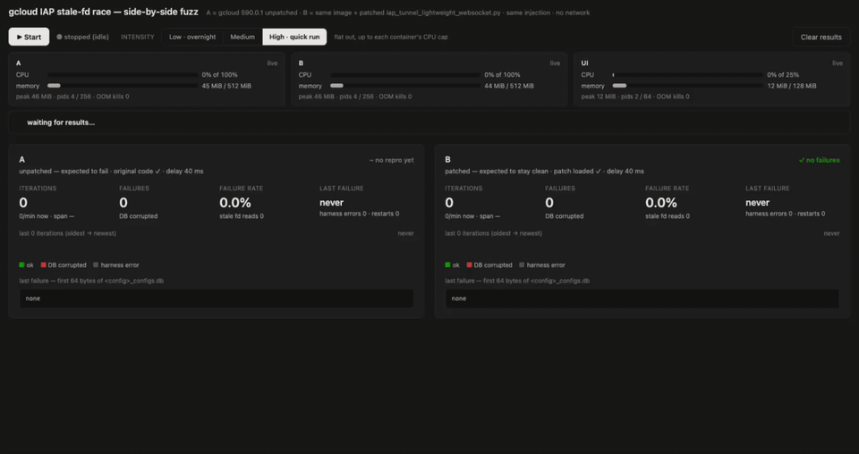

# gcloud-iap-stale-fd-repro

Offline side-by-side repro of a gcloud IAP tunnel race that corrupts the local configs DB. See [USAGE.md](USAGE.md).

## How it shows up

We run many `gcloud compute start-iap-tunnel` sessions from one host to many machines, and SSH connections through
them open and close all day. Every so often, gcloud starts failing with
`gcloud crashed (DatabaseError): file is not a database`. The broken file is `<config>_configs.db`, and it contains one
encrypted TLS alert record (`17 03 03 00 13` + 19 bytes).

## Cause

When a tunnel closes, `close()` can run on one thread while the reader thread is still inside an SSL read. The socket's
fd number is freed, gcloud reopens its configs DB on the same number, and OpenSSL, still holding that number, reads the
DB header as a bad TLS record and writes an alert into the file. The more tunnels open and close, the more often it
happens.

## The fuzz UI

Also at [low](media/ui-low.gif) and [medium](media/ui-medium.gif) intensity.

## Built with Claude

This was done together with [Claude Code](https://claude.com/claude-code). Claude analysed the strace evidence, drafted
the patch, built the offline fuzz and UI, and had a second model audit the code and prose. We checked each claim
against a reproduction before keeping it.
